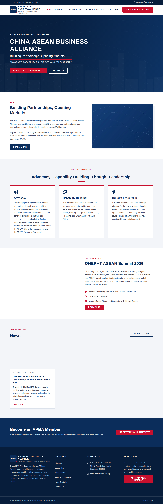
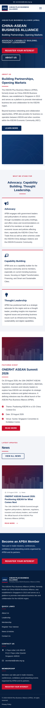
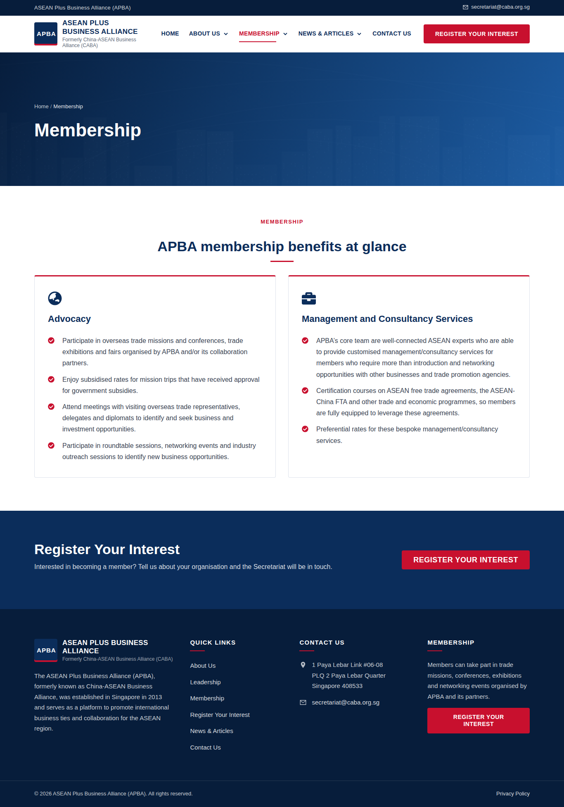
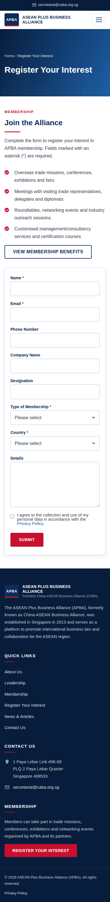
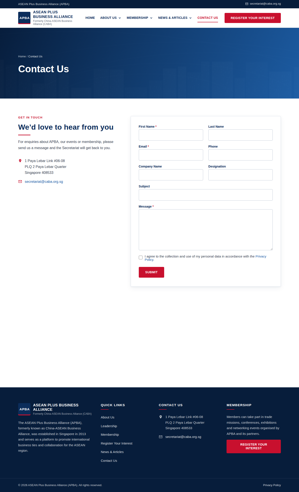
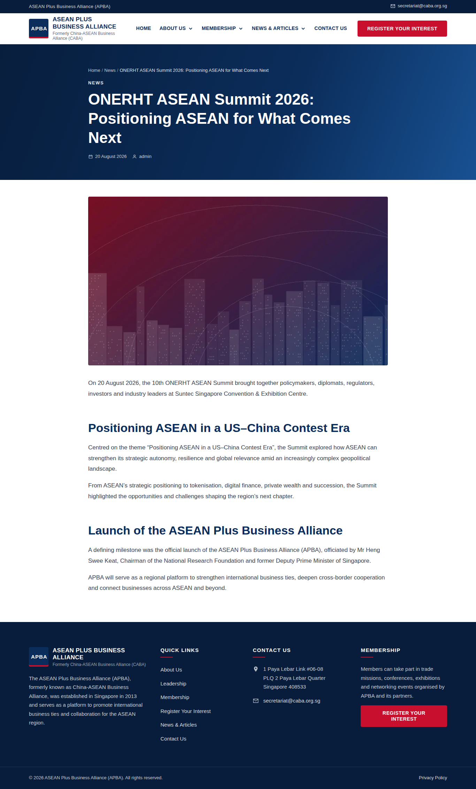
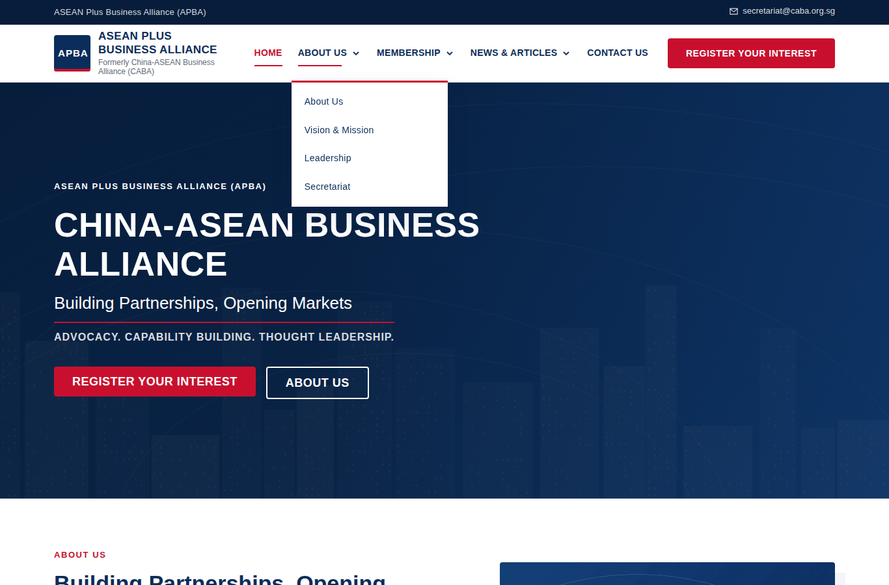
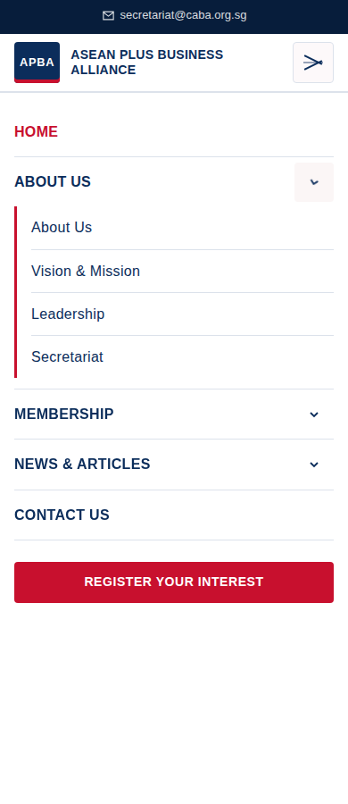

# ASEAN Plus Business Alliance (APBA / formerly CABA) – WordPress + Elementor (free)

A WordPress recreation of the public website at **https://www.caba.org.sg/**, built for **WordPress + standard (free) Elementor**. It needs **no Elementor Pro**. Routine content is edited in WordPress and Elementor, so nobody has to touch PHP to update it.

| What | How it's built (no Elementor Pro) |
|---|---|
| Header, dropdown navigation, mobile menu, CTA button | Child-theme `header.php`, driven by **Appearance → Menus** and **Customizer → APBA Site Options** |
| Footer (links, contact details, dynamic © year) | Child-theme `footer.php`, driven by **Menus** and the **Customizer** |
| Page layouts (Home, About Us, Vision & Mission, Leadership, Secretariat, Membership, Register Your Interest, News, Articles, Contact Us, Privacy Policy) | Free Elementor widgets (Container, Heading, Text Editor, Button, Image, Icon Box, Icon List, Google Maps, Shortcode) |
| News and article grids with pagination | WordPress **Posts + Categories**, shown by the `[apba_posts]` shortcode in Elementor's free **Shortcode** widget (it replaces the Pro Posts/Loop widgets) |
| Single news item / article pages | Child-theme `single.php`: breadcrumbs, metadata, featured image, author box, previous/next links, related posts |
| Register Your Interest and Contact forms | **Contact Form 7** (free), with honeypot + time-trap spam protection, accessible labels, privacy consent, and success/error states |
| Global colours, fonts, buttons, breakpoints | **Elementor → Site Settings** (Global Colors / Global Fonts), which the importer configures. Theme CSS reads the same variables |
| SEO | Meta description, Open Graph, and Organization/Article/Breadcrumb JSON-LD. These switch off automatically when Yoast, Rank Math, AIOSEO, SEOPress or The SEO Framework is active. Canonical URLs, sitemap and robots.txt come from WordPress core |

## Requirements

* WordPress 6.3+ and PHP 7.4+ (tested on PHP 8.3 with WordPress trunk)
* Theme: **Hello Elementor** (free, parent theme)
* Plugins: **Elementor** (free) and **Contact Form 7** (free)
* Optional: one SEO plugin and one caching plugin suited to your host

## Installation

1. Install and activate the **Elementor** and **Contact Form 7** plugins from *Plugins → Add New*.
2. Install the **Hello Elementor** theme from *Appearance → Themes → Add New*. You don't need to activate it.
3. Zip the `wp-content/themes/apba-child` folder, upload it under *Appearance → Themes → Add New → Upload*, and **activate** it.
4. Go to **Appearance → APBA Site Setup** and click **Run setup**. This:
   * imports placeholder images into the Media Library
   * creates the **News** and **Articles** categories and the posts (see *Content* below)
   * creates the two Contact Form 7 forms
   * creates all pages with Elementor layouts, using the *Elementor Full Width* template so the theme header and footer stay in place
   * builds the **Primary**, **Footer** and **Legal** menus and assigns them
   * sets the static front page, privacy page, `/%postname%/` permalinks (only when permalinks are currently "Plain"), date format and Singapore timezone
   * configures **Elementor Site Settings**: global colours, global fonts, heading sizes, buttons, 1200px content width, breakpoints (mobile < 768, tablet 768–991, laptop 992–1199, desktop 1200+), container layout and inline SVG icons
   * saves the Customizer defaults (organisation name, address, email, header button, footer text)

   With WP-CLI you can run `wp apba setup --user=<admin>` instead (`--force` rebuilds the content that setup created).

You can run setup more than once. Published pages that already use the same slugs are left alone. **Rebuild** only overwrites content that setup created itself.

## After setup (launch checklist)

1. **Logo:** *Appearance → Customize → Site Identity → Logo*. Until you set one, a text logo is shown.
2. **Contact details and header button:** *Customize → APBA Site Options*. The phone number is empty because the published site has none.
3. **Images:** replace the placeholder images. Use *Edit with Elementor* on each page, plus the featured images on posts. Upload images at their display size (hero ≈ 1920×820, cards 16:9).
4. **Posts:** older News/Articles items are created as **drafts** that include a link to their source page. Copy each one's full text across, then publish it (see `docs/CONTENT-SOURCES.md`).
5. **Forms:** under *Contact → Contact Forms → Mail*, check the email recipient. If you want, add Cloudflare Turnstile or reCAPTCHA under *Contact → Integration*.
6. **Verify:** check the items flagged in `docs/CONTENT-SOURCES.md` against the live site, including leadership names and the membership types offered.
7. Install an SEO plugin and a caching plugin if your host doesn't provide them.

## Everyday editing (no code)

| Task | Where |
|---|---|
| Change text, buttons or images on a page | *Pages → (page) → Edit with Elementor* |
| Add news or an article | *Posts → Add New*. Pick the **News** or **Articles** category, set a featured image and an excerpt. It then appears on the Home page (News), on `/news/` or `/articles/`, and in related posts |
| Change navigation | *Appearance → Menus* (Primary, Footer and Legal menus) |
| Change address, email, phone, header button, footer text or social links | *Appearance → Customize → APBA Site Options* |
| Change brand colours or fonts site-wide | *Elementor → Site Settings → Global Colors / Global Fonts*. The header and footer follow these too |
| Edit form fields or messages | *Contact → Contact Forms* |

### Shortcodes (free Elementor *Shortcode* widget)

| Shortcode | Purpose |
|---|---|
| `[apba_posts category="news" count="3" columns="3"]` | Card grid of posts. Options: `category` (slug, comma-separated), `count`, `columns` (1–4), `pagination="yes"`, `excerpt="no"`, `exclude_current="yes"`, `heading="h2"` |
| `[apba_breadcrumbs]` | Breadcrumb trail (used in page banners) |
| `[apba_contact_info show="address,email,phone"]` | Contact details from the Customizer |
| `[apba_year]` | Current year |

### Reusable CSS classes (Elementor → Advanced → CSS Classes)

`apba-page-banner` (inner-page banner), `apba-hero`, `apba-box` (bordered card with accent top border), `apba-eyebrow` (small red uppercase label), `apba-title-rule` (heading with accent underline; add `apba-title-rule--center` to centre it), `apba-checklist` (icon list), `apba-framed` (image with offset frame), `apba-feature-media`, `apba-form-card`, `apba-portrait`, `apba-button-outline-light` (white outline button on dark backgrounds).

## Repository layout

```
wp-content/themes/apba-child/
├── style.css                 Theme header (child of hello-elementor)
├── functions.php             Bootstrap
├── header.php / footer.php   Header & footer (menus + Customizer)
├── single.php                News/article template
├── archive.php, index.php, search.php, page.php, 404.php
├── assets/css/main.css       All theme styles (design tokens bridge to Elementor globals)
├── assets/js/navigation.js   Mobile menu + accessible dropdowns (no jQuery)
├── assets/images/            Placeholder images imported by setup
└── inc/
    ├── setup.php             Supports, menus, image sizes, assets
    ├── customizer.php        APBA Site Options
    ├── class-apba-nav-walker.php
    ├── template-tags.php     Logo, breadcrumbs, cards, meta, pagination
    ├── shortcodes.php        [apba_posts] etc.
    ├── forms.php             CF7 conditional loading + spam protection
    ├── seo.php               Meta/OG/JSON-LD (auto-off with SEO plugins)
    ├── performance.php
    └── importer/             One-click setup (Elementor page data, posts, forms, menus, kit)
docs/
├── DESIGN-INVENTORY.md       Tokens, typography, spacing, components, breakpoints
└── CONTENT-SOURCES.md        Where each piece of copy came from + items to verify
tools/generate-placeholders.php
```

## Performance notes

* Globally the theme adds one CSS file (~25 KB unminified) and one deferred JS file (~4 KB, no jQuery dependency).
* Contact Form 7 CSS/JS load only on pages that render a form.
* Elementor is set to use inline SVG icons instead of the Font Awesome font, and `font-display: swap`. To serve fonts from your own domain, turn on *Elementor → Settings → Advanced → Load Google Fonts Locally*.
* Emoji scripts are removed. Block-library CSS is dequeued on Elementor-built pages. Uploaded JPEG sub-sizes are generated as WebP where the server supports it.
* No Elementor add-on packs are used.

## Screenshots

These were rendered from a local test install (WordPress + SQLite, Elementor 4.4, Contact Form 7 6.2) after running setup. They show placeholder images and the default brand tokens. The map iframe is blank only because Google was unreachable from the test environment.

| | |
|---|---|
|  |  |
|  |  |
|  |  |
|  |  |
